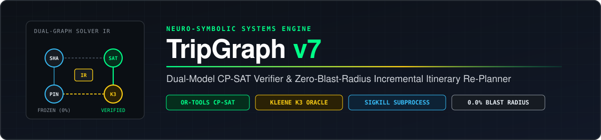
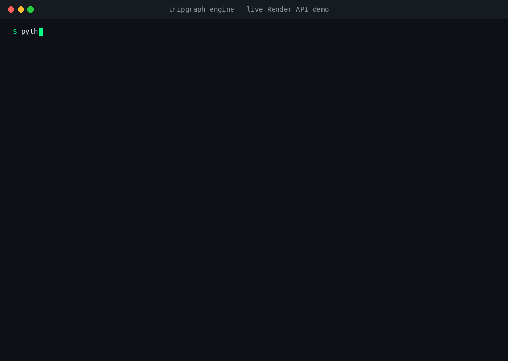
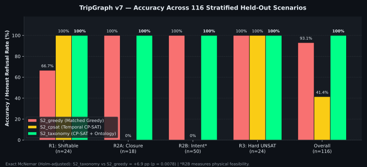
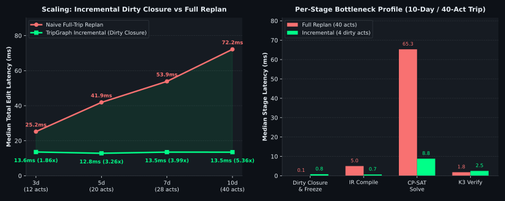

<div align="center">
  

  <p>
    <a href="https://github.com/sainathmanda7/tripgraph-engine/actions/workflows/ci.yml"></a>
    <a href="./docs/performance.md"></a>
    <a href="./docs/performance.md"></a>
    <a href="https://tripgraph-engine.onrender.com/docs"></a>
    <a href="./LICENSE"></a>
  </p>

  <p>
    <strong>An AlphaGeometry-inspired neuro-symbolic verification and incremental re-planning engine for multi-city travel itineraries.</strong><br/>
    Pairs exact <strong>OR-Tools CP-SAT</strong> constraint solving and <strong>Kleene K3</strong> verification with factor-graph dirty closure, SHA-256 freeze locks, and OS-isolated solver subprocesses.
  </p>

  <p>
    <a href="https://tripgraph-engine.onrender.com/docs"><strong>Live Swagger API</strong></a> &bull;
    <a href="./docs/architecture.md"><strong>Architecture (8 Diagrams)</strong></a> &bull;
    <a href="./docs/performance.md"><strong>Benchmarks &amp; Coverage</strong></a> &bull;
    <a href="./docs/system-design.md"><strong>System Design &amp; ADRs</strong></a> &bull;
    <a href="./docs/api.md"><strong>API Reference</strong></a>
  </p>
</div>

---

## Live Production Walkthrough

Running [`scripts/live_demo.py`](./scripts/live_demo.py) against the live Render deployment (`https://tripgraph-engine.onrender.com`) demonstrates:
1. **Kleene K3 Verification (`POST /verify`):** Catches an authoritative Monday closure on Mori Art Museum (`VIOLATED_FALSE`).
2. **Incremental Subprocess Repair (`PATCH /edit`):** Swaps Monday to an open venue (`version=2`, `PROVEN_OPTIMAL_IN_SCOPE`, `VERIFIED_TRUE`) with **`0.0%` blast radius**—untouched Sunday stays SHA-256 frozen.
3. **Async Global Escalation (`202 Accepted` + SSE):** Shifting the trip `+2 days` crosses `dirty_ratio > 0.50`, escalating automatically to a 30s background worker streaming live SSE stages to `version=3`.

<div align="center">
  
</div>

> **Try it live:** Open [https://tripgraph-engine.onrender.com/docs](https://tripgraph-engine.onrender.com/docs) *(Render Free tier — allow ~30s cold start on the very first request)* or run `python3 scripts/live_demo.py https://tripgraph-engine.onrender.com`.

---

## Why TripGraph?

Standard LLM itinerary editors break on two fundamental backend problems: **combinatorial constraint violations** (DST shifts, opening hours, hotel no-show/access contracts, transit physics) and **unbounded blast radius** (regenerating an entire trip when a user edits one afternoon).

| Capability | Engineering Implementation | Verification Proof |
| :--- | :--- | :--- |
| **Dual-Model CP-SAT Compiler** | Single immutable `CompiledConstraintIR` emits a multi-worker `OptimizationModel` (dynamic weights `< 2^53`) and—only on `INFEASIBLE`—a single-worker, zero-objective `DiagnosticFeasibilityModel` with cloned per-constraint optional intervals and bounded 6-probe MUS (`<= 250 ms`). | **60-scenario randomized fuzz proof** asserting direct OptimizationModel core soundness & MUS minimality (`test_milestone4_cpsat_dual_model.py`). |
| **Zero-Blast-Radius Replanning** | Separates acyclic itinerary spine from cyclic constraint factor graph. Day-bin dirty closure projects frozen global budget/anti-dup/quotas onto dirty days and enforces **SHA-256 `LockGuard`** before commit. | **Exhaustive `2^n` projection equivalence tests** (`test_milestone3_graph_and_projections.py`) + **`5.36x` speedup** on 10-day trips. |
| **Kleene K3 Verification** | Three-valued logic (`TRUE` / `FALSE` / `UNKNOWN`) with Pareto single-witness evidence dominance, contractual hotel check-in/no-show/bag-drop state machine, and byte-pinned `ZoneInfo.from_file()` (AST-banned raw `ZoneInfo(key)`). | **25/25 dual agreement** against a zero-shared-code `dateutil` reference oracle (`eval/reference_oracle/`). |
| **Non-Blocking Runtime Isolation** | FastAPI never imports `ortools` (AST-enforced). Solves dispatch to a bounded OS subprocess pool (`start_new_session=True`, Linux `PR_SET_PDEATHSIG(SIGKILL)`) with hard `SIGKILL` timeouts and **atomic SQLite version + request commit fencing**. | **Live `SIGKILL` hang recovery** (`<0.8s`), non-blocking event-loop heartbeat, and stale/aborted write rejection (`test_milestone6_runtime_and_api.py`). |

---

## Measured Performance & Quality Evidence

All figures below are auto-generated from **116 stratified held-out scenarios x 10 timing repeats** (`3,480` total solves) with **two-stage scenario-clustered bootstrap 95% CIs** and zero API keys. Full breakdown and per-module coverage live in [`docs/performance.md`](./docs/performance.md) and [`BENCHMARK_RESULTS.md`](./BENCHMARK_RESULTS.md).

<div align="center">
  
</div>

| Arm (0 LLM Tokens) | Overall Accuracy | R1 Shiftable | R2A Closure | R2B Feasibility* | R3 Hard UNSAT | Blast Radius (Sem / Tmp) | p50 ms | p95 ms | p99 ms |
| :--- | :---: | :---: | :---: | :---: | :---: | :---: | :---: | :---: | :---: |
| **`S2_greedy`** (Matched Greedy) | 93.1% | 66.7% | 100.0% | 100.0% | 100.0% | 0.0% / 0.0% | 1.8 | 4.2 | 8.8 |
| **`S2_cpsat`** (Temporal CP-SAT) | 41.4% | 100.0% | 0.0% | 0.0% | 100.0% | 0.0% / 0.0% | 9.8 | 15.1 | 21.6 |
| **`S2_taxonomy`** (CP-SAT + Ontology) | **100.0%** | **100.0%** | **100.0%** | **100.0%** | **100.0%** | **0.0% / 0.0%** | **13.7** | **29.2** | **40.7** |

- **Exact McNemar (Holm-Bonferroni adjusted):** `S2_taxonomy` outperforms matched `S2_greedy` by **`+6.9 pp`** (`n01=8, n10=0`, **`p = 0.0078`**) and temporal-only `S2_cpsat` by **`+58.6 pp`** (`p = 1.36e-20`).
- **Before / After Scaling Evidence:** Incremental dirty closure holds edit latency flat at **`13.5 ms` ($O(1)$)** from 3-day (12-act) to 10-day (40-act) trips, achieving a **`5.36x` speedup** over naive full-trip replanning (`72.2 ms`) with **`0.0%` semantic blast radius**.

<div align="center">
  
</div>

---

## 2-Minute Zero-Key Quickstart

```bash
git clone https://github.com/sainathmanda7/tripgraph-engine.git
cd tripgraph-engine
python3 -m venv .venv && source .venv/bin/activate
pip install -e ".[dev]"

# 1. Run all 69 tests + coverage report (AST firewalls, 25/25 oracle, 2^n proofs, MUS, SIGKILL, SSE)
make test

# 2. Reproduce the 116-scenario x 10-repeat benchmark into BENCHMARK_RESULTS.md
make bench

# 3. Launch the local FastAPI server (Swagger UI at http://127.0.0.1:8000/docs)
make serve
```

Or run via Docker:
```bash
make docker-up
```

---

## Engineering Documentation Hub

| Document | Contents |
| :--- | :--- |
| **[`docs/architecture.md`](./docs/architecture.md)** | 8 Mermaid architecture diagrams: C4 Container, Component Boundaries, K3 Verification Pipeline, Dual-Graph Factor Projection, Replanning Workflow, Production Deployment, 2 Sequence Diagrams, and Data-Flow Diagram. |
| **[`docs/system-design.md`](./docs/system-design.md)** | Tech stack rationale, SQLite ER schema & atomic fencing SQL, trade-offs, failure/recovery matrix, security posture, known limitations, and roadmap. |
| **[`docs/adr/`](./docs/adr/)** | 5 Architecture Decision Records covering [Dual-Model IR](./docs/adr/001-dual-model-cpsat-ir.md), [SIGKILL Subprocess Pool](./docs/adr/002-subprocess-solver-pool-sigkill.md), [Kleene K3 & Pinned TZDB](./docs/adr/003-kleene-k3-pareto-verification.md), [Dirty Closure & LockGuard](./docs/adr/004-factor-graph-dirty-closure-lockguard.md), and [Fenced SQLite Commits & Async 202](./docs/adr/005-sqlite-fenced-commits-async-replan.md). |
| **[`docs/performance.md`](./docs/performance.md)** | Full benchmark dashboard (`p50`/`p95`/`p99`), incremental ablation profile, 85% coverage table across 2,922 statements, bottleneck analysis, and verified failure demos. |
| **[`docs/api.md`](./docs/api.md)** | Full HTTP & SSE API specification, `200`/`202`/`409`/`503` contracts, and copy-paste `curl` commands. |
| **[`docs/case-study.md`](./docs/case-study.md)** | 1-page executive technical case study covering problem framing, dual-model CP-SAT architecture, `5.36x` scaling results, and production trade-offs. |
| **[`examples/`](./examples/)** | Engine-verified JSON itineraries (`valid_tokyo_trip.json`, `invalid_closed_monday.json`), sync edit payloads, and live `202 Accepted` + SSE transcript. |

---

## Honest Production Limits & Roadmap

- **Single-Container Persistence:** The live Render Free deployment runs `:memory:` SQLite inside a single container (`0.1 vCPU` cold starts can momentarily exceed the `950 ms` H0 cap before warm-up). Roadmap: PostgreSQL (`SELECT ... FOR UPDATE`) + distributed gRPC solver workers.
- **Tier C External Adapters:** Public OSRM (`WALK`/`DRIVE` only, `<= 0.5 req/s`, no SLA) and Overpass (`TIER_3_COMMUNITY`) are integration demos, not commercial GDS feeds; inter-city rail uses static GTFS CSV extracts.
- **Semantic Free-Text Evaluation:** Deterministic CI proves hard-constraint feasibility (`100.0%`) and honest `UNSAT` refusal; live `S3` LLM semantic preference over `S2_taxonomy` is wired via `OpenAICompatibleLLMClient` + 2-rater blind grading (`eval/blind_grade.py`) under exact `>=80%` power and weighted kappa `>=0.60` claim gates.

See [`docs/system-design.md`](./docs/system-design.md#7-known-limitations--future-roadmap) for the full roadmap and [`CONTRIBUTING.md`](./CONTRIBUTING.md) for contribution guidelines.

---

## Author & License

Built by **Sainath Manda** &bull; [GitHub](https://github.com/sainathmanda7) &bull; [Portfolio](https://sainath.root10x.in)  
Released under the [MIT License](./LICENSE).
