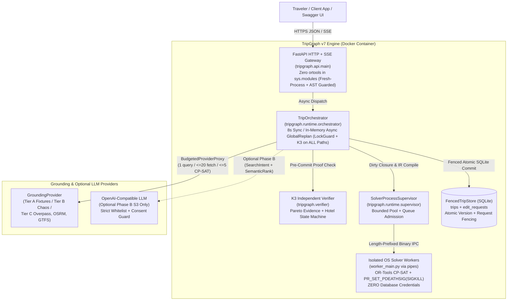
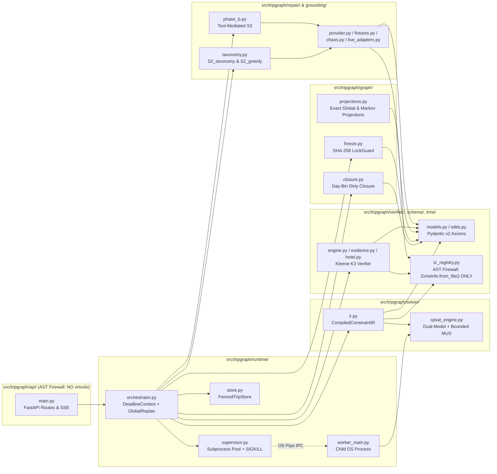
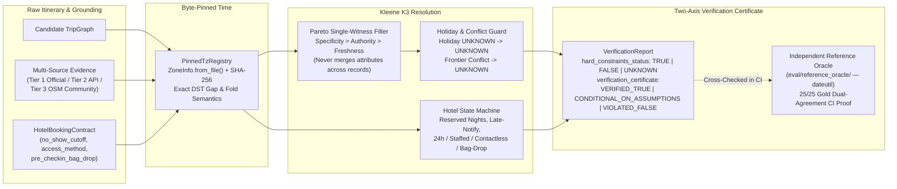
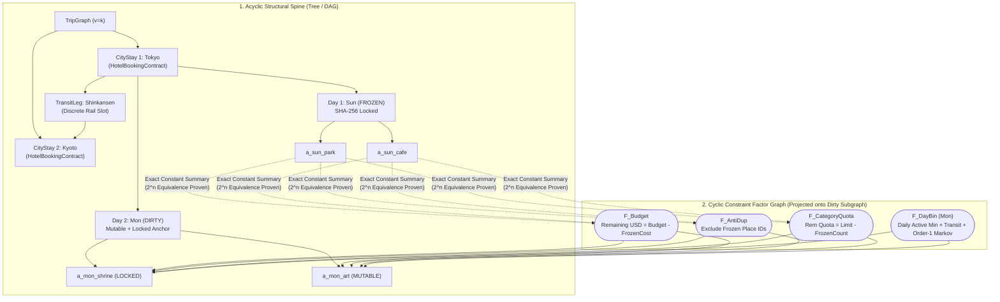
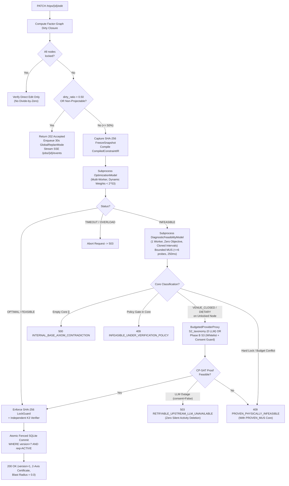
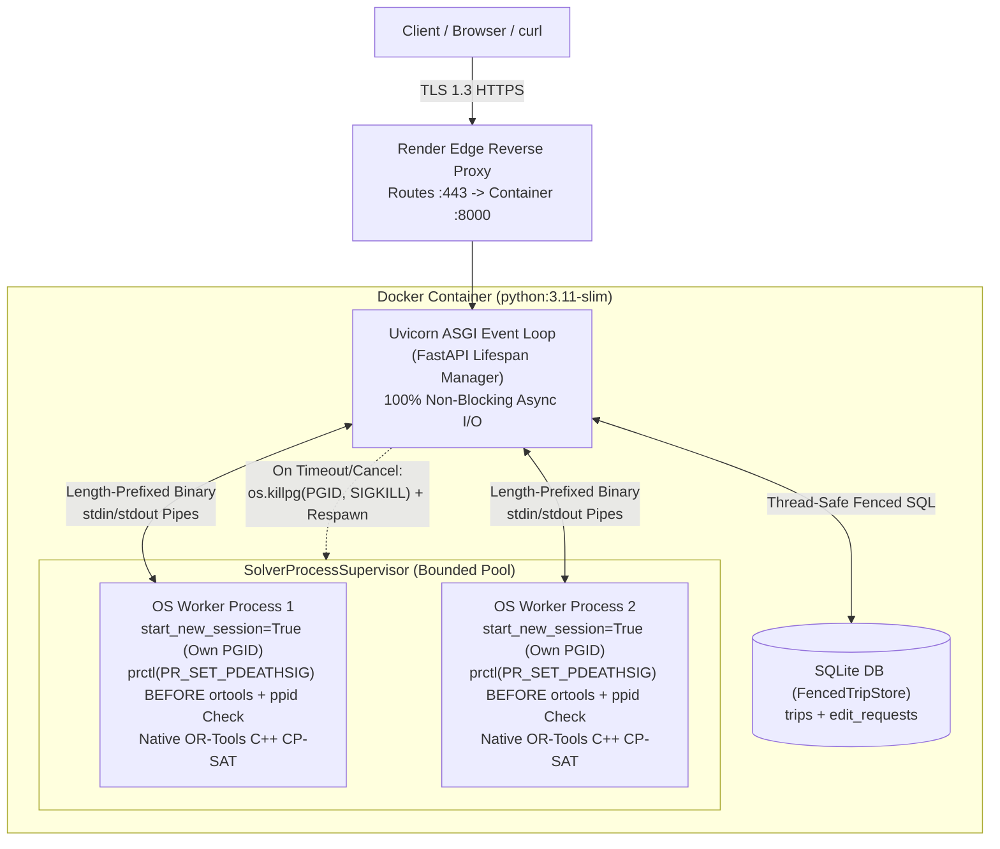
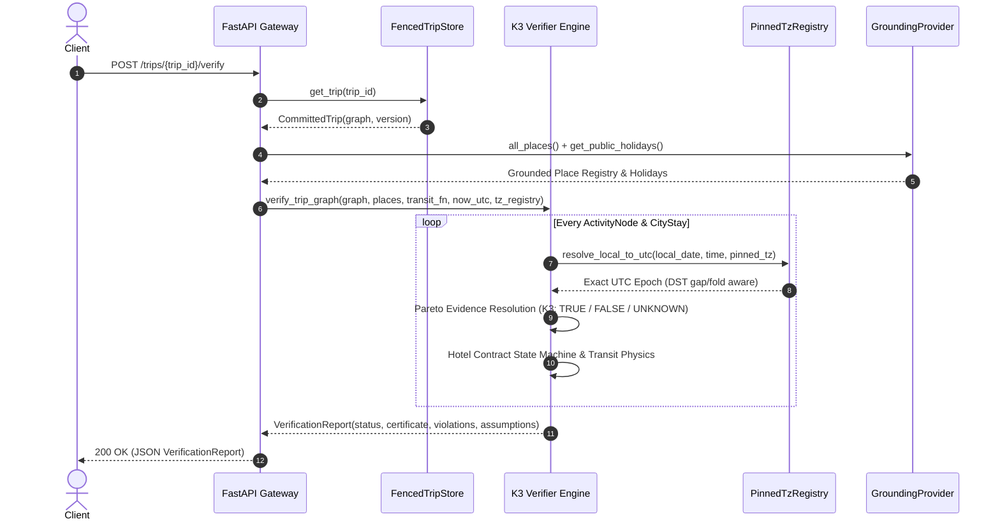
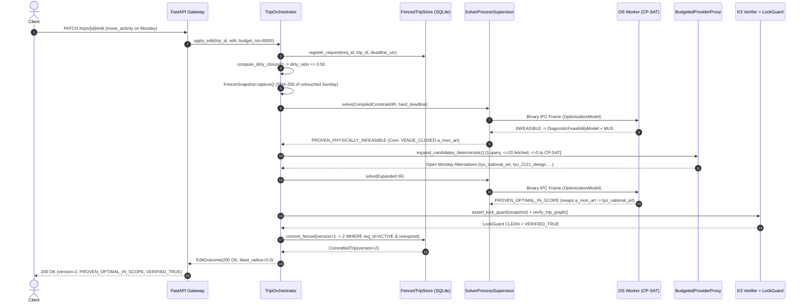
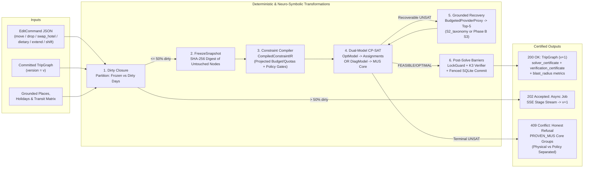

# TripGraph v7 — Architecture & System Design Diagrams

Visual architecture views of `tripgraph-engine` across container, component, verification, dual-graph, workflow, deployment, sequence, and data-flow perspectives. Every boundary below is enforced in code and verified in CI.

---

## 1. High-Level System Architecture (C4 Container)

---

## 2. Detailed Component Architecture

Internal package boundaries and the two **AST-enforced firewalls** verified on every CI run (`tests/test_milestone1_time_and_schema.py` and `tests/test_milestone6_runtime_and_api.py`).

---

## 3. Neuro-Symbolic Verification Pipeline

Resolves multi-source venue evidence and hotel contracts under Kleene three-valued logic (`TRUE`, `FALSE`, `UNKNOWN`) without fabricating certainty from stale, conflicting, or unverified holiday data.

---

## 4. Dual-Graph Architecture (Acyclic Spine + Cyclic Constraint Factor Graph)

Separates the acyclic itinerary hierarchy from cyclic cross-day constraints (budget, venue anti-duplication, category quotas, intra-day Markov adjacency) and projects frozen nodes into exact constants on the dirty subgraph.

---

## 5. Incremental Replanning Workflow

End-to-end decision pipeline inside `TripOrchestrator.apply_edit()`, separating fast synchronous repairs (`8,000 ms` hard ceiling) from heavy global restructurings (`30,000 ms` async worker).

---

## 6. Public Demo Deployment Architecture

Runtime isolation topology running on the public demo deployment at `https://tripgraph-engine.onrender.com` (seeded `FixtureGroundingProvider`, `:memory:` SQLite, in-memory `asyncio` global jobs).

---

## 7. Sequence Diagrams: Verification & Incremental Replanning

### 7A. Independent Verification Sequence (`POST /trips/{trip_id}/verify`)

### 7B. Incremental Replanning Sequence (`PATCH /trips/{trip_id}/edit`)

---

## 8. Data-Flow Diagram (Inputs, Transformations & Certified Outputs)

