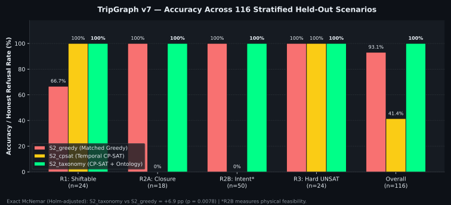

# Performance, Verification & Quality Evidence

All figures below are reproducible locally with **zero API keys** (`pytest --cov=tripgraph`, `make bench`, `python3 scripts/measure_ablation.py`, `PYTHONPATH=. python3 scripts/generate_charts.py`).

> **Measurement Environment & Scope:**
> - **Hardware / Runtime:** Local Linux (WSL2 on x86_64 desktop), Python `3.11.18`, warm-started CP-SAT solver (not end-to-end Render Free Tier HTTP latency).
> - **Timed Operations:** Factor-graph dirty closure + `CompiledConstraintIR` compilation + OR-Tools CP-SAT solve + independent Kleene K3 whole-graph verification.
> - **Dataset:** 116 stratified curated/synthetic held-out benchmark fixtures (`eval/run_benchmark.py`), measuring physical constraint feasibility and honest `UNSAT` refusal -- not real-time external supplier accuracy or free-text user preference.

---

## 1. Benchmark Dashboard (116 Held-Out Fixture Scenarios x 10 Repeats)

Evaluated across **116 stratified held-out fixture scenarios** (`24` R1 shiftable cascades, `18` R2A structured closures, `50` R2B compositional intent, `24` R3 hard-lock `UNSAT`) with **10 timing repeats per scenario** (`3,480` total solves) and **two-stage scenario-clustered bootstrap 95% CIs**.



| Arm | Suite Feasibility / Refusal | R1 Shiftable | R2A Closure | R2B Feasibility* | R3 Hard-Lock Refusal | Blast Radius (Outside Dirty Scope) | Local p50 ms | Local p95 ms | Local p99 ms |
| :--- | :---: | :---: | :---: | :---: | :---: | :---: | :---: | :---: | :---: |
| **`S2_greedy`** (Matched Greedy) | 93.1% | 66.7% | 100.0% | 100.0% | 100.0% | 0.0% / 0.0% | 1.8 | 4.2 | 8.8 |
| **`S2_cpsat`** (Temporal CP-SAT) | 41.4% | 100.0% | 0.0% | 0.0% | 100.0% | 0.0% / 0.0% | 9.8 | 15.1 | 21.6 |
| **`S2_taxonomy`** (CP-SAT + Ontology) | **100.0%** | **100.0%** | **100.0%** | **100.0%** | **100.0%** | **0.0% / 0.0%** | **13.7** | **29.2** | **40.7** |

- **Exact McNemar (`S2_taxonomy` vs `S2_greedy`):** `+6.9 pp` (`n01=8, n10=0`), Holm-Bonferroni adjusted **`p = 0.0078`**.
- **Exact McNemar (`S2_taxonomy` vs `S2_cpsat`):** `+58.6 pp` (`n01=68, n10=0`), Holm-Bonferroni adjusted **`p = 1.36e-20`**.
- **Frozen Controls Integrity:** Verified against `eval/FROZEN_CONTROLS.lock` (`SHA-256: 8eb33186...7968f8`) on every run.
- *\*Epistemic Note:* On `R2B`, deterministic arms evaluate physical feasibility only; free-text sensory preference (`S3` vs `S2_taxonomy`) is evaluated separately via `eval/blind_grade.py` under exact `>=80%` power (`scipy.stats.binom`) and weighted Cohen's kappa `>= 0.60`.


---

## 2. Scaling Ablation: Incremental Dirty Closure vs. Full-Trip Replan (12-40 Activities)

Measuring a single-day activity move across **3, 5, 7, and 10-day itineraries (12 to 40 activities, 10 warm-started repeats each)** via `python3 scripts/measure_ablation.py`:


| Trip Length | Total Activities | Incremental Dirty Closure p50 | Naive Full-Trip Replan p50 | Speedup | Incremental Stage Profile (Compile / Solve / Verify) | Blast Radius (Outside Dirty Scope) |
| :---: | :---: | :---: | :---: | :---: | :---: | :---: |
| 3 days | 12 | **13.57 ms** | 25.21 ms | **1.86x** | `0.7 / 11.3 / 1.2 ms` | **0.0%** |
| 5 days | 20 | **12.84 ms** | 41.90 ms | **3.26x** | `0.7 / 10.1 / 1.4 ms` | **0.0%** |
| 7 days | 28 | **13.50 ms** | 53.88 ms | **3.99x** | `0.7 / 10.1 / 2.0 ms` | **0.0%** |
| 10 days | 40 | **13.47 ms** | 72.19 ms | **5.36x** | `0.7 / 8.8 / 2.5 ms` | **0.0%** |

### Scaling & Bottleneck Analysis
1. **Tested Workload Range (~13-14 ms at p50, 12-40 activities):** Incremental edit latency stayed nearly flat across this tested workload range because day-bin dirty closure holds CP-SAT search local to the touched day (`8.8-11.3 ms`). This is an empirical result over 12-40 activities, **not** an asymptotic $O(1)$ end-to-end guarantee.
2. **Whole-Graph K3 Verification Scales Linearly $O(|V|)$ (`1.2 ms` &rarr; `2.5 ms`):** Deliberately re-verifies every node in the post-edit `TripGraph` as an independent pre-commit safety barrier. On very large graphs (`|V| >> 40`), verification eventually dominates compile/solve time.
3. **IR Compilation (`0.7 ms`):** Negligible overhead across tested day bins.
4. **Public Demo Hardware Caveat:** Render Free Tier (`0.1 vCPU`) experiences ~30s cold starts and slower CPU throughput than local benchmarks.

---

## 3. Automated Test Suite & Statement Coverage

**78 / 78 tests passing** (`pytest --cov=tripgraph --cov-report=term-missing`) with **88% statement coverage across 3,077 Python statements** (measured via `pytest-cov`, not raw source LOC).

Key verified suites:
- **Milestone 1 (`test_milestone1_time_and_schema.py`):** AST ban on `ZoneInfo(key)`, TZif SHA-256 byte pinning, DST spring-forward/fall-back, Stage-0 axioms, hotel contract guards.
- **Milestone 2 (`test_milestone2_verifier_and_oracle.py`):** 25/25 dual agreement with zero-shared-code `dateutil` reference oracle (`eval/reference_oracle/`).
- **Milestone 3 (`test_milestone3_graph_and_projections.py`):** Exhaustive $2^n$ projection equivalence, dirty-ratio escalation, zero-unlocked guard, SHA-256 `LockGuard`.
- **Milestone 4 (`test_milestone4_cpsat_dual_model.py`):** 60-scenario randomized dual-model equivalence & direct MUS core soundness fuzzing, zero silent policy pruning.
- **Milestone 5 (`test_milestone5_grounding_and_phase_b.py`):** Equal-budget `BudgetedProviderProxy`, `S2_taxonomy` vs greedy trap, async Phase B hallucination firewall & consent-gated outage safety, Tier B chaos & Tier C OSM/OSRM/GTFS guards.
- **Milestone 6 (`test_milestone6_runtime_and_api.py`):** Non-blocking event loop heartbeat, `SIGKILL` hang recovery (`<0.8s`), atomic SQLite commit fencing, sync `200` and async `202` + SSE flows.
- **Milestone 7 (`test_milestone7_benchmark_and_stats.py`):** Frozen controls lock integrity, exact binomial power, Cohen's kappa claim gate, 116-scenario benchmark verification.
- **Sprint 1 P0 Hardening (`test_sprint1_p0_hardening.py`):** Fresh-process `'ortools' not in sys.modules` API check, Phase B supervisor subprocess routing across all 3 solve paths, `GlobalReplanMode` + `ALL_LOCKED_VERIFY_ONLY` `LockGuard` & policy-gated `UNKNOWN` commit barriers, honest `NOT_INVOKED_VERIFY_ONLY` certificate, `worker_main.py` lazy import + `prctl`/`ppid` failure checks.
- **Sprint 2 Mutation & Multi-City (`test_sprint2_mutations_and_demo.py`):** DST spring-forward/fall-back wall-clock preservation, `TransitLeg` + `ExtendStayEdit` propagation, cross-city `city_id` & destination venue swap, end-to-end 2-city Tokyo &rarr; Kyoto demo verification.

*Note on `worker_main.py` coverage:* The worker executes inside an isolated OS child subprocess outside parent `pytest-cov` tracing; its `prctl`/`ppid` error paths and lazy-import invariant are verified directly in `test_worker_pdeathsig_fails_loudly_and_imports_solver_lazily`.

---

## 4. Reproducible Commands

```bash
# 1. Full test suite + line-by-line statement coverage (78 tests)
pytest -v --cov=tripgraph --cov-report=term-missing

# 2. Fresh-process zero-ortools API isolation check
python3 -c "import sys, tripgraph.api.main; assert not any(m == 'ortools' or m.startswith('ortools.') for m in sys.modules); print('CLEAN')"

# 3. 116 held-out fixture scenarios x 10 timing repeats -> BENCHMARK_RESULTS.md
make bench

# 4. Incremental vs full-replan scaling ablation -> eval/ablation_metrics.json
python3 scripts/measure_ablation.py

# 5. Regenerate all 3 dark-mode SVG charts into assets/
PYTHONPATH=. python3 scripts/generate_charts.py
```
