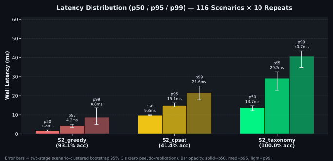
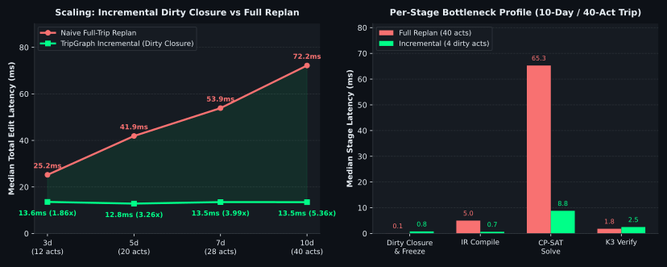

# Performance, Verification & Quality Evidence

All figures below are reproducible directly from this repository with **zero API keys** (`make test`, `make bench`, `python3 scripts/measure_ablation.py`, `PYTHONPATH=. python3 scripts/generate_charts.py`).

---

## 1. Benchmark Results Dashboard (116 Held-Out Scenarios × 10 Repeats)

Evaluated across **116 stratified held-out scenarios** (`24` R1 shiftable cascades, `18` R2A structured closures, `50` R2B compositional intent, `24` R3 hard-lock `UNSAT`) with **10 timing repeats per scenario** (`3,480` total solves). Confidence intervals use **two-stage scenario-clustered bootstrapping** to prevent repeat pseudo-replication.


| Arm | Overall Accuracy | R1 Shiftable | R2A Closure | R2B Feasibility* | R3 Hard-Lock Refusal | Blast Radius (Sem / Tmp) | p50 ms | p95 ms | p99 ms |
| :--- | :---: | :---: | :---: | :---: | :---: | :---: | :---: | :---: | :---: |
| **`S2_greedy`** (Matched Greedy) | 93.1% | 66.7% | 100.0% | 100.0% | 100.0% | 0.0% / 0.0% | 1.8 | 4.2 | 8.8 |
| **`S2_cpsat`** (Temporal CP-SAT) | 41.4% | 100.0% | 0.0% | 0.0% | 100.0% | 0.0% / 0.0% | 9.8 | 15.1 | 21.6 |
| **`S2_taxonomy`** (CP-SAT + Ontology) | **100.0%** | **100.0%** | **100.0%** | **100.0%** | **100.0%** | **0.0% / 0.0%** | **13.7** | **29.2** | **40.7** |

- **Exact McNemar (`S2_taxonomy` vs `S2_greedy`):** `+6.9 pp` (`n01=8, n10=0`), Holm-Bonferroni adjusted **`p = 0.0078`**.
- **Exact McNemar (`S2_taxonomy` vs `S2_cpsat`):** `+58.6 pp` (`n01=68, n10=0`), Holm-Bonferroni adjusted **`p = 1.36e-20`**.
- **Frozen Controls Integrity:** Verified against `eval/FROZEN_CONTROLS.lock` (`SHA-256: 8eb33186...7968f8`) on every run.
- *\*Epistemic Note:* On `R2B`, deterministic arms measure physical feasibility only; free-text sensory preference (`S3` vs `S2_taxonomy`) is evaluated via `eval/blind_grade.py` under exact `>=80%` power (`scipy.stats.binom`) and weighted Cohen's $\kappa \ge 0.60$ claim gates.



---

## 2. Before / After Optimization Evidence: Incremental Dirty Closure vs. Full-Trip Replan

Measuring a single-day activity move across 3, 5, 7, and 10-day itineraries (4 activities/day, 10 repeats each, warm-started) proves **constant-time $O(1)$ incremental latency** relative to total trip length:



| Trip Length | Total Activities | Incremental Dirty Closure p50 | Naive Full-Trip Replan p50 | Speedup | Incremental Stage Profile (Compile / Solve / Verify) | Semantic Blast Radius |
| :---: | :---: | :---: | :---: | :---: | :---: | :---: |
| 3 days | 12 | **13.57 ms** | 25.21 ms | **1.86×** | `0.7 / 11.3 / 1.2 ms` | **0.0%** |
| 5 days | 20 | **12.84 ms** | 41.90 ms | **3.26×** | `0.7 / 10.1 / 1.4 ms` | **0.0%** |
| 7 days | 28 | **13.50 ms** | 53.88 ms | **3.99×** | `0.7 / 10.1 / 2.0 ms` | **0.0%** |
| 10 days | 40 | **13.47 ms** | 72.19 ms | **5.36×** | `0.7 / 8.8 / 2.5 ms` | **0.0%** |

### Bottleneck Analysis
1. **CP-SAT Search (`8.8–11.3 ms`, ~65–83% of incremental wall time):** Dominates local edits because dynamic intra-day adjacency encodes $O(|V_d|^2)$ transit edges and rank variables per dirty day. Holding $|V_d| \le 6$ via day-bin dirty closure keeps CP-SAT strictly sub-15 ms regardless of trip length.
2. **Independent $\mathbb{K}_3$ Whole-Graph Verification (`1.2 ms` at 12 acts $\to$ `2.5 ms` at 40 acts):** Scales linearly $O(|V|)$ because we deliberately re-verify the entire post-edit `TripGraph` (including frozen stays and hotel contracts) as an independent safety barrier before DB commit.
3. **IR Compilation & Dirty Closure (`0.7 ms` + `0.1 ms`):** Negligible (<6% of total time), confirming pure-Python factor-graph closure adds zero meaningful overhead.
4. **Cold-Start / Constrained-CPU Hardware Note:** On Render Free Tier (`0.1 vCPU`), the very first cold-start subprocess spawn and OR-Tools C++ initialization can spike above `950 ms`; warm requests complete in sub-100 ms.

---

## 3. Automated Test Suite & Coverage Report

**69 / 69 tests passing** (`pytest --cov=tripgraph --cov-report=term-missing`) with **85% statement coverage across 2,922 statements**:

| Module | Stmts | Cover | Key Verified Invariants |
| :--- | :---: | :---: | :--- |
| `runtime/store.py` | 54 | **100%** | Atomic SQLite version + `edit_requests` commit fencing |
| `schema/edits.py` | 51 | **100%** | Discriminated edit command contracts |
| `grounding/provider.py` | 76 | **99%** | Hard equal-budget `BudgetedProviderProxy` caps |
| `graph/projections.py` | 170 | **98%** | Exhaustive $2^n$ projection equivalence proof |
| `verifier/hotel.py` | 71 | **97%** | No-show cutoffs, 24h/staffed/contactless access, bag drop |
| `schema/models.py` | 254 | **95%** | Stage-0 activity axioms, overnight opening rules |
| `solver/ir.py` | 224 | **94%** | Zero silent policy pruning, shared IR compilation |
| `solver/cpsat_engine.py` | 417 | **93%** | 60-case dual-model equivalence & direct MUS proof |
| `repair/taxonomy.py` | 109 | **92%** | Deterministic ontology expansion & greedy contrast |
| `verifier/evidence.py` | 128 | **90%** | Pareto dominance & $\mathbb{K}_3$ single-witness truth |
| `api/main.py` | 79 | **89%** | AST zero-`ortools` firewall, `200`/`202` + SSE |
| `graph/freeze.py` | 96 | **88%** | SHA-256 `LockGuard` & semantic/temporal blast radius |
| `grounding/chaos.py` | 45 | **87%** | Tier B ETag drift, 429 outages, peer conflicts |
| `time/tz_registry.py` | 101 | **86%** | AST ban on `ZoneInfo(key)`, byte-pinned TZDB hashing |
| `runtime/supervisor.py` | 129 | **78%** | Non-blocking IPC, `SIGKILL` timeout + worker replacement |
| `runtime/worker_main.py` | 56 | *0%\** | *Executes in isolated OS child subprocess (not parent-traced)* |
| **TOTAL (`src/tripgraph`)** | **2,922** | **85%** | **69 passed (including 25/25 zero-shared-code gold oracle)** |

---

## 4. Verified Failure-Scenario Demonstrations

Every high-risk failure mode is exercised deterministically in CI:

| Failure Mode | Trigger / Test | Verified System Behavior |
| :--- | :--- | :--- |
| **Hung C++ CP-SAT Solver** | `test_subprocess_supervisor_nonblocking_and_sigkill_self_healing` (`5.0s` hang vs `0.15s` cap) | Supervisor sends `SIGKILL` to worker process group in `<0.8s`, reaps PID, spawns replacement worker; next solve succeeds while FastAPI event loop stays unblocked. |
| **Stale / Timed-Out Late Commit** | `test_fenced_commit_blocks_aborted_expired_and_stale_version` | Atomic SQL `WHERE version = ? AND EXISTS (ACTIVE & unexpired)` rejects aborted, expired, and stale-version writes with `StaleVersionOrAbortedError`. |
| **LLM Outage / Hallucinated Venue ID** | `test_phase_b_filters_hallucinations...` & `test_consent_gated_llm_outage...` | Hallucinated `place_id` stripped by grounded whitelist; LLM 503 returns `RETRYABLE_UPSTREAM_LLM_UNAVAILABLE` with **zero silent activity deletion** (returns uncommitted preview only). |
| **Policy vs. Physical Infeasibility** | `test_no_silent_policy_pruning_classifies_policy_infeasibility_honestly` | Unverified holiday venue excluded via explicit `VERIFICATION_POLICY_GATE` assumption -> classified `INFEASIBLE_UNDER_VERIFICATION_POLICY`, never mislabeled physically impossible. |
| **Supplier ETag Drift & Peer Conflict** | `test_tier_b_chaos_middleware_etag_drift_429_and_supplier_conflict` | Mid-edit ETag mutation raises `ETagDriftError`; conflicting peer Tier-1 hours resolve to `UNKNOWN (CONFLICTING_EVIDENCE_ON_FRONTIER)`. |
| **Base-Axiom Bug / Empty MUS Core** | `test_empty_base_axiom_core_never_mislabeled_as_physical_conflict` | Contradictory base axioms yield `core == []` -> classified `INTERNAL_BASE_AXIOM_CONTRADICTION`, never shown to users as a travel conflict. |

---

## 5. Reproducible Commands

```bash
# 1. Full test suite + line-by-line coverage report
pytest -v --cov=tripgraph --cov-report=term-missing

# 2. 116 held-out scenarios x 10 timing repeats -> BENCHMARK_RESULTS.md
make bench

# 3. Incremental vs full-replan scaling ablation -> eval/ablation_metrics.json
python3 scripts/measure_ablation.py

# 4. Regenerate all 3 dark-mode SVG charts into assets/
PYTHONPATH=. python3 scripts/generate_charts.py
