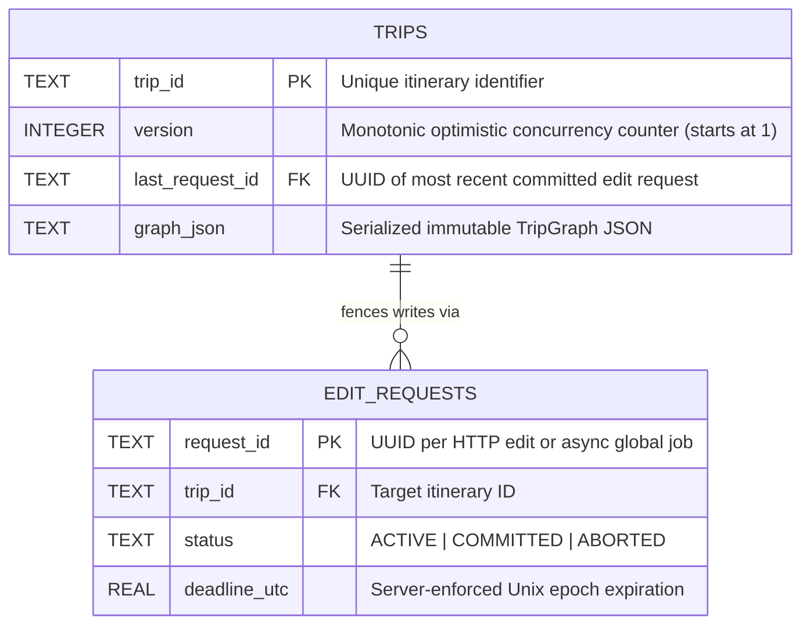

# TripGraph v7 — System Design Document

## 1. Problem Statement & Core Invariants

Multi-day travel itineraries break standard LLM pipelines in two ways:
1. **Combinatorial Fragility:** Shifting one activity cascades across opening hours, DST boundaries, hotel no-show/access contracts, intra-day transit durations, daily active limits, and trip-wide budget/anti-duplication rules.
2. **Unbounded Blast Radius:** Naive full-plan regeneration mutates days the traveler already approved, eroding trust and inflating latency linearly with trip length.

TripGraph enforces five non-negotiable invariants:
- **Zero-Unintended-Mutation Guarantee:** Untouched days are SHA-256 hashed before solving (`FreezeSnapshot`) and asserted unmodified before commit (`LockGuard`).
- **Dual-Model Soundness:** Optimization and infeasibility diagnosis compile from one immutable `CompiledConstraintIR` with zero silent policy pruning.
- **Epistemic Honesty (Kleene K3):** Stale, conflicting, or unverified holiday data resolves to `UNKNOWN`, never silently promoted to `VERIFIED_TRUE`.
- **Non-Blocking Native Execution:** `CpSolver.solve()` never runs inside FastAPI's event loop (enforced by AST CI firewall).
- **Atomic Fenced Persistence:** Timed-out, aborted, or stale computations cannot overwrite committed state.

---

## 2. Technology Stack & Rationale

| Layer | Technology | Rationale | Rejected Alternative |
| :--- | :--- | :--- | :--- |
| **Constraint Solver** | **OR-Tools CP-SAT** | Native C++ SAT/CP hybrid handles Boolean reification (`OnlyEnforceIf`), optional intervals (`AddNoOverlap`), dynamic hierarchical integer weights, and `AddAssumptions` cores in `~10 ms`. | Pure LLM prompting (no feasibility proof); greedy heuristics (trapped by coupled locked windows, `-6.9 pp` accuracy). |
| **API & Streaming** | **FastAPI + Uvicorn (Python 3.11)** | Native async SSE streaming (`202 Accepted` global replans), automatic OpenAPI/Swagger generation, Pydantic v2 validation. | Flask/Django WSGI (blocks workers on SSE streams); pure Go/Rust (loses direct OR-Tools CP-SAT Python bindings & SciPy stats). |
| **Schema Validation** | **Pydantic v2 (Frozen Models)** | Immutable `TripGraph` snapshots prevent accidental in-place aliasing and enforce Stage-0 axioms at parse time. | Plain dicts / mutable dataclasses (silent mutation bugs during diff/freeze). |
| **Process Isolation** | **OS Subprocesses (`start_new_session=True`)** | Native C++ CP-SAT ignores Python `asyncio.CancelledError`; process-group `SIGKILL` + Linux `PR_SET_PDEATHSIG` guarantees hard timeouts and zero orphans. | `asyncio.to_thread` / `ThreadPoolExecutor` (cannot kill hung C++ threads; leaks CPU under load). |
| **Persistence** | **SQLite (`FencedTripStore`)** | Single-file ACID transactions supporting atomic conditional `UPDATE ... WHERE version = ? AND EXISTS (...)` with zero external DB ops overhead. | Unfenced in-memory dict (lost writes, race conditions on concurrent edits). |
| **Time & TZDB** | **Byte-Pinned `ZoneInfo.from_file()`** | Eliminates silent OS TZDB drift across Docker/CI hosts via SHA-256 file hashing; AST-banned raw `ZoneInfo(key)`. | `pytz` (deprecated); unpinned `ZoneInfo(key)` (silent host TZDB mismatch). |
| **Independent Oracle** | **`python-dateutil`** | Zero-shared-code reference verifier (`eval/reference_oracle/`) eliminates confirmation bias across 25 adversarial DST/hotel/evidence tests. | Testing the verifier against its own helper functions. |

---

## 3. Database Schema & Atomic Commit Fencing (ER Diagram)



### Atomic Fenced Commit SQL (`src/tripgraph/runtime/store.py`)

Every commit executes in one serialized SQLite transaction. If a request times out (marked `ABORTED`), passes `deadline_utc`, or races against a concurrent write (`version` advanced), `rowcount == 0` and `StaleVersionOrAbortedError` is raised:

```sql
UPDATE trips
SET graph_json = ?, version = version + 1, last_request_id = ?
WHERE trip_id = ?
  AND version = ?
  AND EXISTS (
      SELECT 1 FROM edit_requests
      WHERE request_id = ?
        AND trip_id = ?
        AND status = 'ACTIVE'
        AND deadline_utc > ?
  );
```

---

## 4. Trade-Offs & Alternative Approaches

| Design Area | Chosen Approach | Trade-Off Accepted |
| :--- | :--- | :--- |
| **Local Stability vs. Global Optimality** | Horizon 0 day-bin dirty closure (`<= 50%` unlocked nodes); escalate `> 50%` to 30s async `GlobalReplanMode`. | A local repair may miss a globally cheaper swap on an untouched day, deliberately trading small objective improvements for **0.0% unintended blast radius** and **5.36x faster p50** at 10 days (`13.5 ms` vs `72.2 ms`). |
| **Dual-Model CP-SAT vs. Single Model** | Separate `OptimizationModel` (multi-worker, hierarchical objective) and `DiagnosticFeasibilityModel` (1 worker, zero objective, assumptions). | Requires maintaining one shared IR compiler (`ir.py`) and verifying model equivalence across 60 fuzz cases in CI, because OR-Tools prohibits `AddAssumptions` with multi-worker objectives. |
| **Exact Projections vs. Full Re-Verification** | Project frozen nodes into constants during CP-SAT solve, then run full-graph K3 verification before commit. | Pays `~1.2-2.5 ms` linear verification overhead on commit in exchange for an independent defense-in-depth barrier catching any solver or materialization bug. |
| **Subprocess Pipes vs. gRPC / Celery** | Persistent length-prefixed stdin/stdout worker pool inside the container. | Keeps deployment single-container (`Dockerfile`) with sub-millisecond local IPC, trading away horizontal multi-node worker autoscaling (future roadmap). |

---

## 5. Failure Handling & Recovery Matrix

| Component | Failure Mode | Detection Mechanism | Recovery / User Contract |
| :--- | :--- | :--- | :--- |
| **CP-SAT Worker** | Native C++ hang / timeout | `asyncio.timeout(hard_deadline_sec)` | `os.killpg(pgid, SIGKILL)`, async PID reap, immediate fresh worker respawn; client receives `503 INDETERMINATE_SOLVER_TIMEOUT`; request marked `ABORTED`. |
| **Solver Pool** | Traffic spike / saturation | `in_flight >= max_workers + max_queue_depth` or `250 ms` queue wait | Fail fast with `503 SOLVER_OVERLOADED` (protects event loop & tail latency). |
| **Master Process** | OOM / `SIGKILL` crash | Linux `prctl(PR_SET_PDEATHSIG, SIGKILL)` | Kernel instantaneously kills all child solver workers (zero orphan processes). |
| **Upstream LLM** | HTTP 429 / 5xx / timeout (`>1.4s`) | `LLMOutageError` in `phase_b.py` | Default `allow_auto_drop_optional=False`: returns `503 RETRYABLE_UPSTREAM_LLM_UNAVAILABLE` + uncommitted preview (zero silent activity deletion). |
| **LLM Output** | Hallucinated `place_id` | Strict set intersection against `BudgetedProviderProxy` fetched pool | Rejected IDs logged in `rejected_hallucinated_ids`; falls back to untried grounded pool if needed. |
| **Grounding Supplier** | Mid-edit inventory ETag change | `BudgetedProviderProxy.verify_etags_unchanged()` | Raises `ETagDriftError`; blocks stale commit cleanly. |
| **Concurrent Edit** | Two users edit `version=1` simultaneously | SQLite `WHERE version = ?` fence | First commit advances `version=2`; second receives `409 STALE_VERSION_OR_ABORTED`. |
| **Compiler Bug** | Optimization/Diagnostic disagreement or empty MUS core | Runtime equivalence & empty-core guards | Emits `500 INTERNAL_MODEL_EQUIVALENCE_ERROR` or `INTERNAL_BASE_AXIOM_CONTRADICTION`—never blames user constraints. |

---

## 6. Security & Reliability Considerations

- **Least-Privilege Worker Isolation:** Solver subprocesses (`worker_main.py`) hold **zero** SQLite connections, API keys, or filesystem write responsibilities.
- **Bounded Compute & Retrieval:** Hard `8,000 ms` synchronous request budget (`500 ms` commit reserve), bounded MUS cap (`<= 6` probes x `20 ms`, `250 ms` total), and `BudgetedProviderProxy` limits (`1` query, `<= 20` fetched, `<= 5` injected into CP-SAT).
- **Dynamic Integer Overflow Guard:** Hierarchical objective weights `(W1, W2, W3)` are computed from actual instantiated CP-SAT domains and asserted `< 2^53` before solving (`ObjectiveOverflowError`).
- **Input Hardening:** Pydantic v2 strict validation rejects malformed timestamps, inverted intervals (`end <= start`), invalid overnight offsets, and unknown edit discriminators (`422 Unprocessable Entity`).
- **Known Security Scope:** Public demo deployment omits authentication/rate-limiting middleware and uses pickle over trusted private parent-child pipes; production multi-tenant deployment should add JWT/API-key auth, per-tenant rate limiting, and Protobuf/JSON IPC serialization.

---

## 7. Known Limitations & Future Roadmap

### Known Limitations
1. **Single-Container SQLite Persistence:** The Render Free demo uses `:memory:` SQLite (state resets on container restart) and scales vertically within one container.
2. **Tier C External Adapters Are Integration Demos:** Public OSRM (`WALK`/`DRIVE` only, `<= 0.5 req/s`, no SLA) and Overpass (`TIER_3_COMMUNITY`) lack commercial GDS SLAs; inter-city rail uses static GTFS extracts rather than live disruption feeds.
3. **Free-Text Semantic Evaluation:** Deterministic CI verifies hard-constraint feasibility (`100.0%` on 116 scenarios); live `S3` vs `S2_taxonomy` semantic quality requires an OpenAI-compatible API key plus 2-rater blind grading (`eval/blind_grade.py`).

### Roadmap
- [ ] **PostgreSQL + Advisory Row Locks:** Replace SQLite with PostgreSQL (`SELECT ... FOR UPDATE`) for multi-replica horizontal API scaling.
- [ ] **Distributed Solver Workers (gRPC/Protobuf):** Move `worker_main.py` behind a stateless worker pool with JSON/Protobuf IPC instead of local pipes.
- [ ] **Live Commercial Grounding Connectors:** Plug real Google Places / Amadeus / live GTFS-RT feeds behind `GroundingProvider`.
- [ ] **Multi-City Inter-Stay Rail Re-Optimization:** Extend Horizon 1 widening to jointly re-solve discrete inter-city rail timetables and hotel check-in nights during flight delays.
- [ ] **Live 8-Arm LLM Benchmark Publication:** Execute `B0`, yoked `B0_multi`, `B1`, `S1a`, `S1b`, and `S3` across `temp=0.0` and `temp=0.3` with 2-rater blind human grading on the 50 Regime-2B cases.
