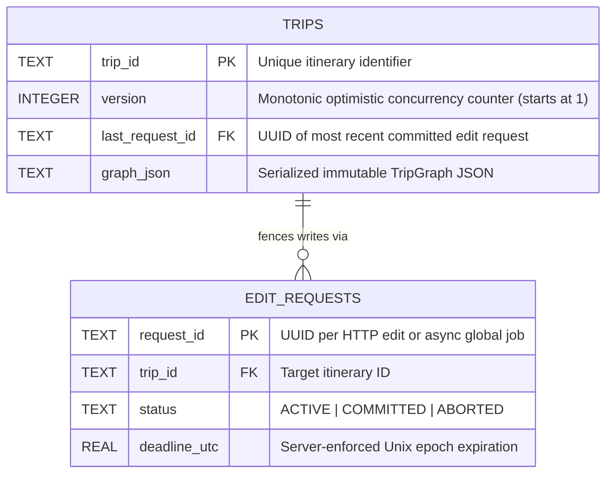

# TripGraph v7 -- System Design Document

## 1. Scope & Core Invariants

TripGraph v7 is a **constraint optimization and itinerary verification engine component** built to sit underneath travel platforms (OTAs, DMCs, and agent itinerary builders). It does **not** manage live supplier inventory, commercial rate sheets, taxes, currency conversions, or payment/booking execution.

Core enforced invariants:
- **Zero Unintended Churn Outside Dirty Scope:** Untouched stays, legs, and activities outside the computed dirty closure are SHA-256 hashed pre-mutation (`FreezeSnapshot`) and verified unmodified pre-commit (`LockGuard`).
- **Commit-Path Parity:** Every commit path (`DAY_BIN`, `ALL_LOCKED_VERIFY_ONLY`, and async `GLOBAL_REPLAN`) enforces `LockGuard`, independent Kleene K3 verification, and policy-gated `UNKNOWN` checks before calling `commit_fenced()`.
- **True OS Process Isolation:** Pure-Python `solver/types.py` ensures `ortools` never enters the API process's `sys.modules`. All native CP-SAT solves (Phase A, Phase B, and GlobalReplanMode) dispatch to isolated Linux worker subprocesses (`PR_SET_PDEATHSIG(SIGKILL)` armed *before* importing `ortools`, `ppid` validated, two-stage readiness handshake).
- **Dual-Model Soundness:** Optimization and infeasibility diagnosis compile from one immutable `CompiledConstraintIR` with zero silent policy pruning.
- **Atomic Fenced Persistence:** Timed-out, aborted, or stale computations cannot overwrite committed SQLite state.

---

## 2. Explicit Kleene K3 `UNKNOWN` Commit Contract

Both `compile_dirty_ir()` and `TripOrchestrator._check_verification_commit_gate()` share one policy function (`is_epistemic_allowed()` in `src/tripgraph/solver/ir.py`) so planning and pre-commit verification never disagree:

| `VerificationPolicy` | Authoritative `FALSE` | `CONFLICTING_EVIDENCE_ON_FRONTIER` / Stale / Unparseable `UNKNOWN` | `HOLIDAY_UNVERIFIED` `UNKNOWN` | Weekly Non-Holiday Fallback `UNKNOWN` |
| :--- | :---: | :---: | :---: | :---: |
| **`STRICT`** | Blocked (`409`/`500`) | Blocked | Blocked | Blocked |
| **`ASSUME_WEEKLY_NON_HOLIDAY`** *(default)* | Blocked | Blocked | Blocked | Permitted provisionally (`CONDITIONAL_ON_ASSUMPTIONS` + explicit `assumptions_accepted`) |
| **`ALLOW_UNVERIFIED_HOLIDAYS`** | Blocked | Blocked | Permitted provisionally (`CONDITIONAL_ON_ASSUMPTIONS` + explicit `assumptions_accepted`) | Permitted provisionally |

---

## 3. Explicit Locked-Node & Calendar Semantics

- **Locked-Node Global Shift Contract (`ShiftStartDateEdit`):** Defaults to `allow_shift_locked=False`. If any stay, transit leg, or activity has `locked_by_user=True`, the edit fails fast with **`409 LOCKED_NODE_CONFLICT`** listing all locked node IDs. Passing `allow_shift_locked=True` explicitly shifts locked nodes by `delta_days` in calendar/wall-clock space and pins those shifted hashes in `FreezeSnapshot` so CP-SAT still cannot drop, swap, or reschedule them.
- **DST-Safe Calendar Shifting (`shift_utc_preserving_local_time`):** Shifts resolve target `(local_date, local_time)` through byte-pinned `PinnedTzRegistry` (PEP 495 fold + `shift_forward` gap semantics) rather than adding raw `86400` seconds.
- **Cross-City Integrity:** `MoveActivityEdit` updates both `stay_id` and `city_id` (preserving wall-clock time in the target stay's timezone if `target_start_utc` is omitted). `compile_dirty_ir()` marks `place.city_id != act.city_id` as `CROSS_CITY_PLACE_MISMATCH`, triggering grounded destination-city candidate replacement.
- **Downstream Propagation:** `ShiftStartDateEdit` and `ExtendStayEdit` shift downstream stays, downstream activities, and affected `TransitLeg` departures/arrivals consistently.

---

## 4. Database Schema & Atomic Commit Fencing (ER Diagram)



```sql
UPDATE trips
SET graph_json = ?, version = version + 1, last_request_id = ?
WHERE trip_id = ?
  AND version = ?
  AND EXISTS (
      SELECT 1 FROM edit_requests
      WHERE request_id = ?
        AND trip_id = ?
        AND status = 'ACTIVE'
        AND deadline_utc > ?
  );
```

---

## 5. Failure Handling & Recovery Matrix

| Component | Failure Mode | Detection Mechanism | Recovery / User Contract |
| :--- | :--- | :--- | :--- |
| **CP-SAT Worker** | Native C++ hang / timeout | `asyncio.timeout(hard_deadline_sec)` | `os.killpg(pgid, SIGKILL)`, async PID reap, immediate fresh worker respawn (Stage 1 `pdeathsig_armed` handshake); client receives `503 INDETERMINATE_SOLVER_TIMEOUT`; request marked `ABORTED`. |
| **Worker Startup** | `prctl` failure or parent died before arming | Non-zero `prctl()` return / `os.getppid() != expected_ppid` | Worker exits loudly (`sys.exit(2)` before importing `ortools`); supervisor fails startup handshake and reaps child. |
| **Solver Pool** | Traffic spike / saturation | `in_flight >= max_workers + max_queue_depth` or `250 ms` wait | Fail fast with `503 SOLVER_OVERLOADED`. |
| **Upstream LLM (Phase B)** | HTTP 429 / 5xx / timeout (`>1.4s`) | `LLMOutageError` | Default `allow_auto_drop_optional=False`: returns `503 RETRYABLE_UPSTREAM_LLM_UNAVAILABLE` + uncommitted preview (zero silent activity deletion). |
| **Global / All-Locked Commit** | Tampered/locked mutation or K3/policy violation | `assert_lock_guard()` + `_check_verification_commit_gate()` | Request aborted; returns `409`/`500` (sync) or emits `failed` SSE stage (global); committed version unchanged. |
| **Concurrent Edit** | Two agents edit `version=1` concurrently | SQLite `WHERE version = ?` fence | First commit advances `version=2`; second receives `409 STALE_VERSION_OR_ABORTED`. |

---

## 6. Security & Reliability Boundaries

- **Least-Privilege Worker Isolation:** Solver subprocesses (`worker_main.py`) hold zero DB connections, API keys, or filesystem write responsibilities.
- **No Unbounded Compute:** Hard `8,000 ms` sync ceiling (`500 ms` commit reserve), bounded MUS cap (`<= 6` probes x `20 ms`, `250 ms` total), `BudgetedProviderProxy` limits (`1` query, `<= 20` fetched, `<= 5` to CP-SAT), and dynamic `< 2^53` integer overflow assertion.
- **Public Demo Security Scope:** Public demo deployment omits auth/rate-limiting middleware and uses pickle over private parent-child pipes; multi-tenant production deployment should add JWT/API-key auth, per-tenant rate limits, and Protobuf/JSON IPC.

---

## 7. Known Limitations & Future Roadmap

### Known Limitations
1. **Non-Durable In-Memory Global Jobs:** `GlobalReplanMode` runs via `asyncio.create_task()` inside the API process with job records and SSE event lists stored in `self.jobs` (in-memory dict). An API restart during an in-flight `202` job interrupts execution and drops event history; clients must re-query `GET /trips/{id}` to verify whether the commit completed.
2. **Seeded Fixture Evidence in Demo Deployment:** Public demo runs `FixtureGroundingProvider` (no live supplier inventory, commercial pricing/taxes, or booking execution) and `:memory:` SQLite.
3. **Tier C Adapters Are Integration Demos:** Public OSRM (`WALK`/`DRIVE`, `<= 0.5 req/s`) and Overpass (`TIER_3_COMMUNITY`) lack commercial GDS SLAs; rail uses static GTFS CSV extracts.
4. **No Idempotency-Key Deduplication Yet:** Retrying an identical `PATCH /edit` request after a network drop can re-apply if the client does not supply optimistic version / idempotency tracking.

### Roadmap
- [ ] **Durable Job Queue + PostgreSQL (`SELECT ... FOR UPDATE`):** Move `GlobalReplanMode` jobs out of in-memory `asyncio` tasks into a durable queue (Redis/Postgres) with restart recovery and client `Idempotency-Key` support.
- [ ] **Stateless gRPC/Protobuf Solver Workers:** Decouple `worker_main.py` for horizontal multi-node scaling.
- [ ] **Commercial Supplier & DMC Adapters:** Implement `GroundingProvider` adapters for live hotel/rail inventory, supplier rate sheets, and pricing callbacks.
- [ ] **Live 8-Arm LLM Evaluation:** Execute `B0`, `B0_multi`, `B1`, `S1a`, `S1b`, and `S3` with 2-rater blind grading (`eval/blind_grade.py`) on the 50 Regime-2B cases.
